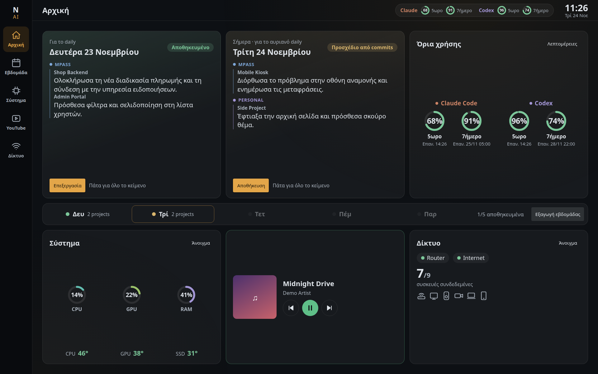
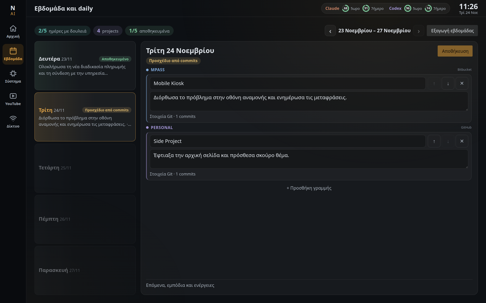
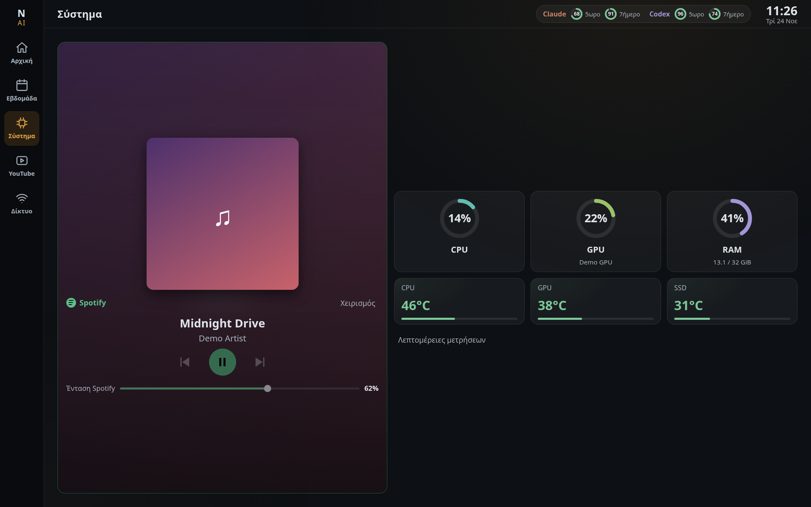
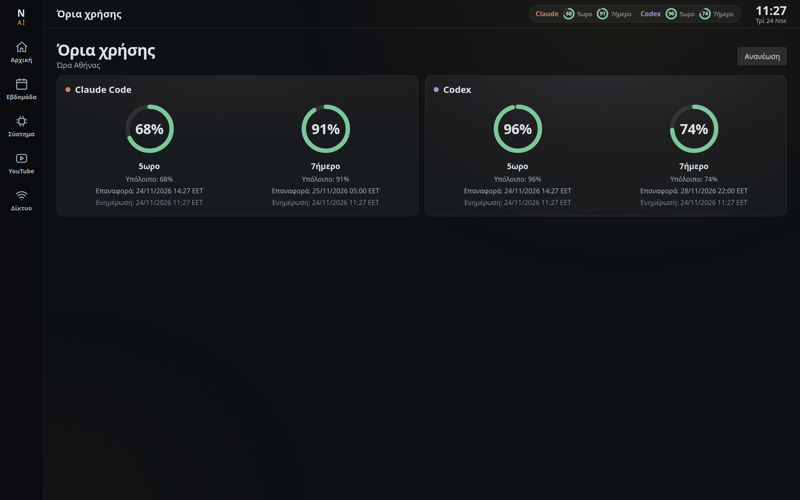
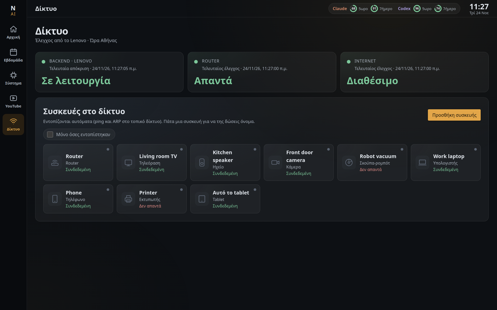
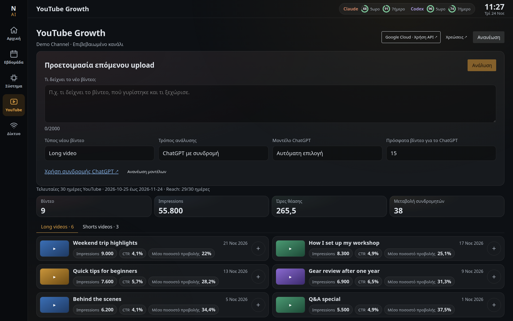
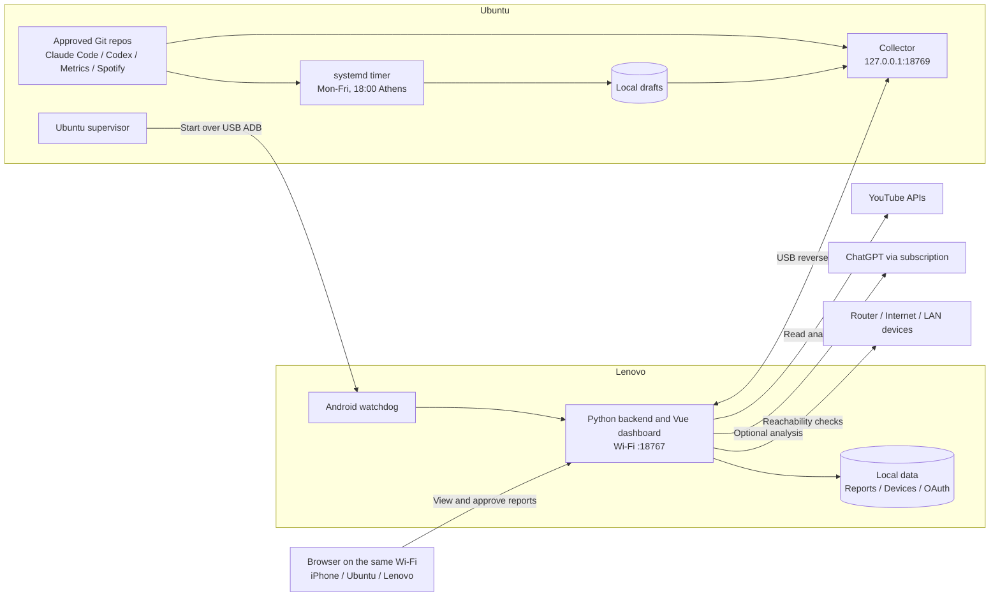

# NEXUS AI

[Ελληνικά](README.md) · **English**

A local tablet dashboard that brings together weekly activity and daily stand-ups, Claude Code and Codex usage limits, Ubuntu metrics, Spotify, network checks and YouTube Growth. **Ubuntu collects** the work data. The **Lenovo tablet serves** the dashboard and keeps the approved reports. The interface is in Greek.



## Screenshots

All screenshots come from the demo mode with **synthetic data** (see [Demo mode](#demo-mode)). They contain no real projects, devices or accounts.

| | |
|---|---|
| <br>**Week and daily.** Day list with an editor, grouped as MPASS and Personal. | <br>**System.** CPU/GPU/RAM rings, temperatures and Spotify. |
| <br>**Usage limits.** 5-hour and 7-day windows for Claude Code and Codex. | <br>**Network.** Automatic device discovery with type icons. |
| <br>**YouTube Growth.** Video metrics and next-upload preparation. | |

## Features

- **Home.** An at-a-glance board: the **For the daily** card (the previous working day, which is what you report at the next morning's stand-up), today's activity, usage limits, the week, system, Spotify and network. The two work cards open a popup with the full text. Alerts appear when a limit drops below 15% or the router/Internet is down.
- **Week and daily in one page.** A day list on the left and an editor for the selected day on the right. Lines are grouped as **MPASS** (Bitbucket) and **Personal** (GitHub). Edit, add, reorder or delete lines and save with one click. When new commits arrive, a newer suggestion is offered but never applied unless you choose it. **Export week** opens a full-screen view of the previous (or current) week per project, ready to copy into e-mail or Slack, with a switch for personal projects.
- **Natural Greek stand-ups.** Sentences are first produced by local rules and then rephrased through the Codex CLI using your existing ChatGPT subscription. Only the project name and commit subjects are sent, never diffs, code or paths. On failure the local wording is kept.
- **Usage limits.** Claude Code is read from the status line (allowed by the MPASS policy), Codex from its App Server. Four values are always visible in the top bar.
- **System.** Ubuntu metrics and Spotify control over MPRIS, with a cover-art player.
- **Network.** The tablet checks the router and the Internet and **discovers devices automatically** (ping sweep and ARP, names from reverse DNS or mDNS). The type is estimated from the name (router, camera, phone, TV, speaker, ...) and you can set your own name or type.
- **YouTube Growth.** Up to 50 recent public videos with 30-day metrics, retention and an analysis assistant for the next upload.
- **Night dimming** from 23:00 to 07:00.

## Architecture



While the Lenovo stays on, the watchdog keeps running with Ubuntu switched off. History, Network and YouTube Growth stay available as long as they can reach their services. New Git data, CLI limits, system metrics and Spotify need the Ubuntu collector and the USB bridge. After the tablet itself restarts, the supervisor starts the watchdog again once the tablet is connected over authorized USB.

The tablet's Wi-Fi address is **not fixed**: the watchdog finds the current address, enables Wi-Fi when it is off and restarts the server when the address changes. The Android apps find their own address and retry automatically.

## Quick start

You need Python **3.10+** with time zone data and Node **22.12+** (LTS). Tested with Python 3.14 and Node 24. From the repository root:

```bash
npm --prefix frontend ci
npm --prefix frontend run build
nexus_dev_data=$(mktemp -d)
NEXUS_DATA_DIR="$nexus_dev_data" python3 -B -m backend.web --bind 127.0.0.1 --port 8767
```

Open `http://127.0.0.1:8767/`. The Python server serves the Vue build from `frontend/dist/`. Features that need the Ubuntu collector or an external connection show "Μη διαθέσιμο" (unavailable).

### Demo mode

To try the UI without Git repositories, devices or accounts, `scripts/demo_server.py` serves the build with **synthetic data** and stores nothing:

```bash
npm --prefix frontend run build
python3 scripts/demo_server.py --port 8790
```

Open `http://127.0.0.1:8790/`. The screenshots in `docs/images/` were produced this way (1920×1200 window, like the tablet).

## Operating the Lenovo installation

With the tablet on USB and on the same Wi-Fi, from Ubuntu:

```bash
systemctl --user status nexus-lenovo-pilot.service nexus-ubuntu-collector.service
systemctl --user list-timers nexus-daily-standup.timer
adb -d get-state
adb -d reverse --list
adb -d shell ip -4 addr show wlan0          # the tablet's current Wi-Fi address
curl -fsS "http://${LENOVO_IP:?set the tablet Wi-Fi address}:18767/api/status"
```

ADB must report `device` and the reverse list must contain `tcp:18769 tcp:18769`. If ADB says `unauthorized`, unlock the tablet and accept the USB debugging prompt. To restart the Ubuntu services:

```bash
systemctl --user restart nexus-ubuntu-collector.service nexus-lenovo-pilot.service
systemctl --user start nexus-daily-standup.timer
journalctl --user -u nexus-ubuntu-collector.service -u nexus-lenovo-pilot.service -n 40 --no-pager
```

### Updating the installed version

```bash
scripts/deploy_lenovo.sh            # add --no-build to skip the frontend build
```

The script builds the frontend, copies the assets and the Python modules that already exist on the tablet into its `release/` directory, and terminates the server so the watchdog restarts it with the new code. A change to `lenovo_watchdog.sh` itself needs a separate watchdog restart, because the running Android supervisor keeps executing the old version.

For a new APK, `frontend/android/build.sh <output-dir>` uses `JAVA_HOME`, `ANDROID_HOME`, Android SDK 34, Build Tools 34.0.0 and the local signing settings `NEXUS_ANDROID_KEYSTORE` and `NEXUS_ANDROID_KEYSTORE_PASSWORD`.

### Services and a fresh Ubuntu

The systemd units live outside the checkout in `~/.config/systemd/user/`. Recreate them with the absolute checkout path as `WorkingDirectory`:

| File | Settings |
|---|---|
| `nexus-ubuntu-collector.service` | `Type=simple`, `ExecStart=/usr/bin/python3 -B -u -m backend.collector`, `Restart=always`, `WantedBy=default.target`. |
| `nexus-lenovo-pilot.service` | Same, with `ExecStart=/usr/bin/python3 -B -u -m backend.lenovo_supervisor`. |
| `nexus-daily-standup.service` | `Type=oneshot`, `ExecStart=/usr/bin/python3 -B -m backend.scheduled`. |
| `nexus-daily-standup.timer` | `OnCalendar=Mon..Fri *-*-* 18:00:00 Europe/Athens`, `Persistent=true`, `WantedBy=timers.target`. |

```bash
systemctl --user daemon-reload
systemctl --user enable --now nexus-ubuntu-collector.service nexus-lenovo-pilot.service nexus-daily-standup.timer
```

The checkout contains the code only. A tablet without an installed runtime also needs a compatible portable Python 3.13 with its libraries, the `~/.local/state/nexus-lenovo-pilot/remote` pointer, the `tz/Europe/Athens` and `tz/America/Los_Angeles` files and the layout below, restored from a trusted local copy.

```text
<remote>/bin/python3.13
<remote>/lib/
<remote>/tz/
<remote>/release/launch.py
<remote>/release/lenovo_watchdog.sh
<remote>/release/backend/
<remote>/release/frontend/dist/
<remote>/production-data/
```

## Connections

### Spotify

The device token is stored inside the Android app, so it survives address changes. With the tablet on USB, pair it without a QR code: `python3 -m backend.spotify_pairing --lenovo`. For other devices use the QR (`python3 -m backend.spotify_pairing`), valid for five minutes and one device. Revoke from **System → Control → Disconnect device**.

### YouTube Growth and ChatGPT

Enable **YouTube Data API v3**, **YouTube Analytics API** and **YouTube Reporting API** in the same Google Cloud project, add your account as a test user if the app is in Testing, create a **Desktop app** OAuth client and keep its JSON outside the checkout. From Ubuntu, with the tablet on USB, run separately:

```bash
python3 -B -m backend.youtube_pair /path/to/client.json UC...
python3 -B -m backend.chatgpt_pair
```

Open each official authorization link in the Ubuntu browser. The first verifies the Channel ID, the second asks permission to use your ChatGPT subscription (it needs the Python `cryptography` library). The first Reach report can take up to 24 hours, so Impressions and CTR may be missing at first. When approval is missing, the service is unavailable or a limit is reached, a local analysis is shown instead.

## Privacy, data and repositories

- Reports, device data and OAuth tokens are stored locally, outside Git: on the tablet in `NEXUS_DATA_DIR` (`production-data/`) and on Ubuntu in `~/.local/share/nexus-ai/drafts/` unless `NEXUS_DRAFTS_DIR` is set.
- Only NEXUS AI source code and documentation go to GitHub. Company repositories stay in Bitbucket. Company source code, full diffs, conversations, raw logs and credentials are never collected or stored. Only the summary data needed for the stand-up is kept.
- Keep OAuth JSON, tokens, reports, logs, the signing keystore and local settings outside the checkout.
- See [docs/architecture.md](docs/architecture.md) (Greek) and [AGENTS.md](AGENTS.md) for details and constraints.
