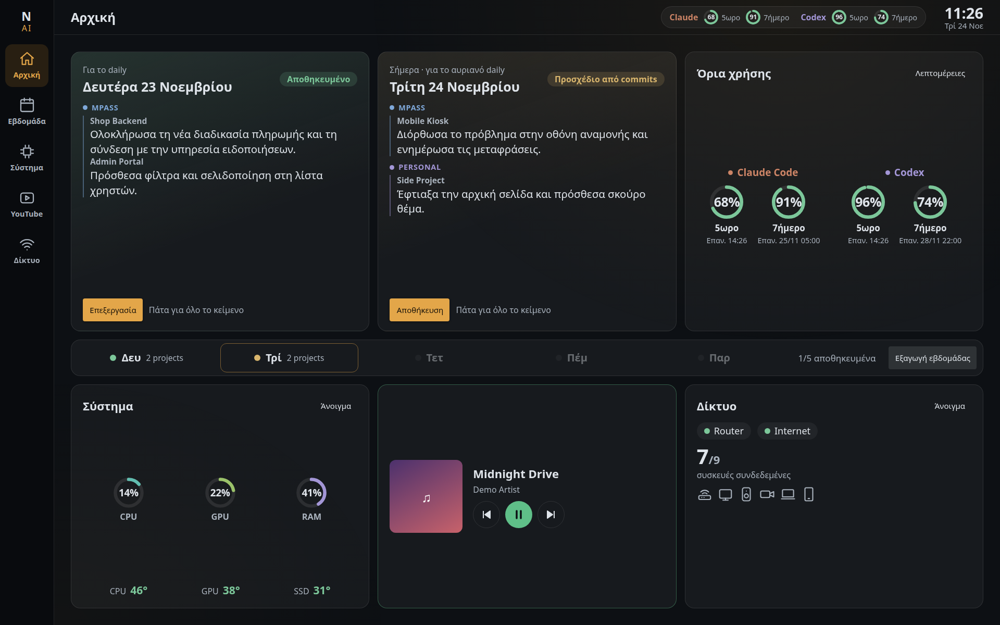
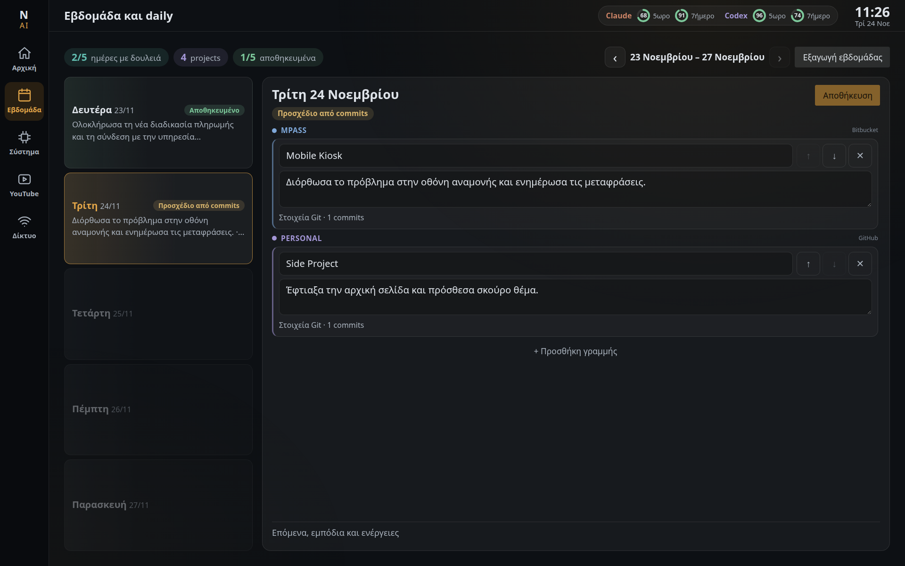
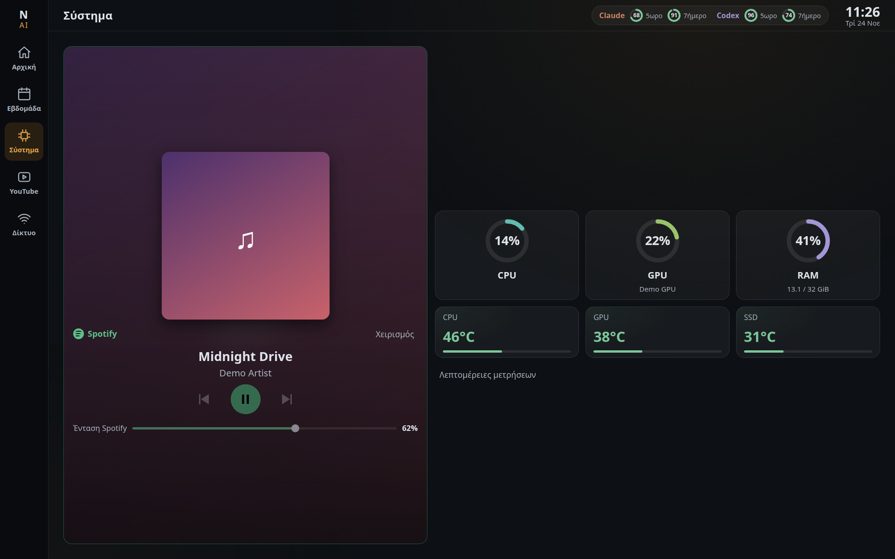
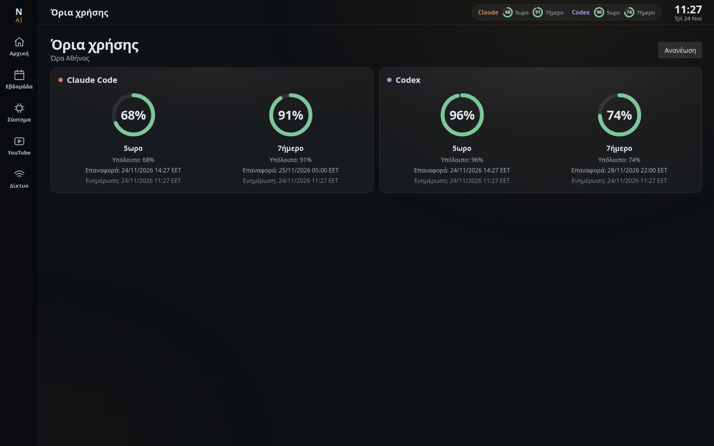
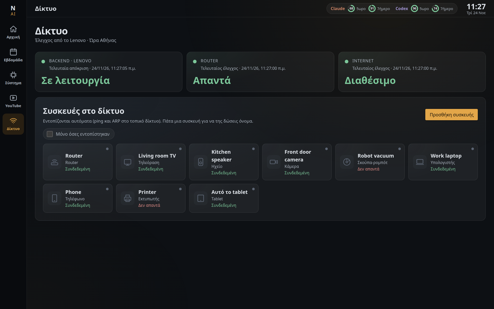
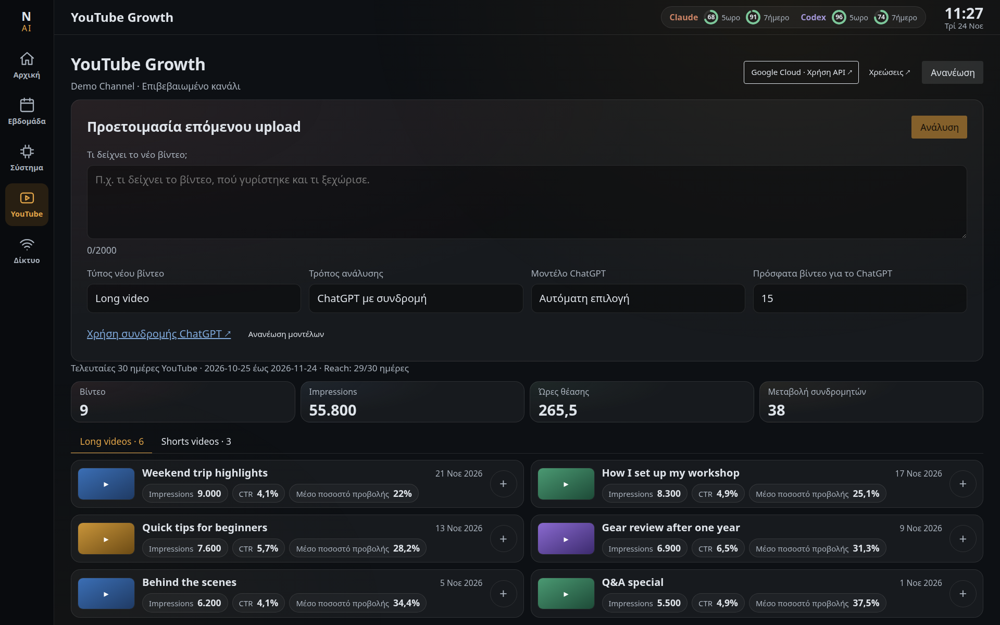
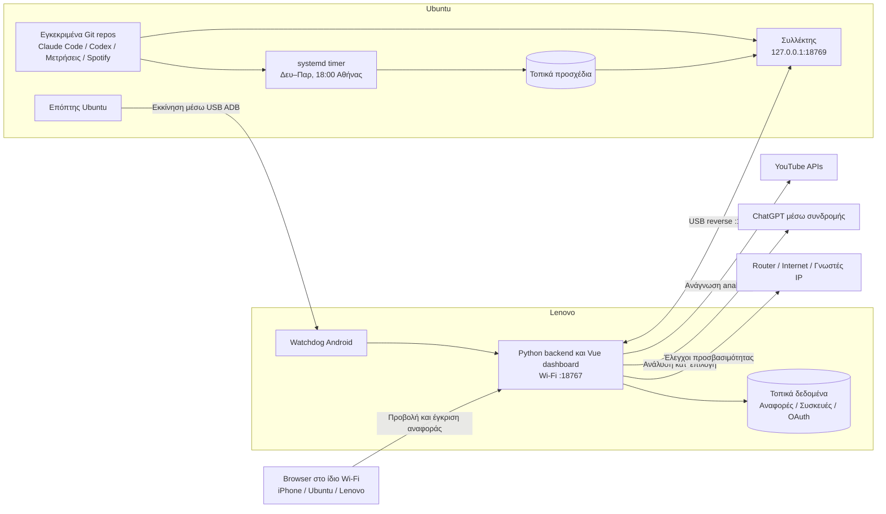

# NEXUS AI

**Ελληνικά** · [English](README.en.md)

Τοπικό dashboard για tablet που συγκεντρώνει εβδομαδιαία δραστηριότητα και daily stand-up, όρια Claude Code και Codex, μετρήσεις Ubuntu, Spotify, έλεγχο δικτύου και YouTube Growth. Το **Ubuntu συλλέγει** τα δεδομένα εργασίας. Το **Lenovo σερβίρει** το dashboard και κρατά τις εγκεκριμένες αναφορές.



## Στιγμιότυπα

Όλα τα στιγμιότυπα προέρχονται από τη λειτουργία επίδειξης με **συνθετικά δεδομένα** (δες [παρακάτω](#λειτουργία-επίδειξης)). Δεν περιέχουν πραγματικά projects, συσκευές ή λογαριασμούς.

| | |
|---|---|
| <br>**Εβδομάδα και daily.** Λίστα ημερών και επεξεργαστής, με ομάδες MPASS και Personal. | <br>**Σύστημα.** Δακτύλιοι CPU/GPU/RAM, θερμοκρασίες και Spotify. |
| <br>**Όρια χρήσης.** 5ωρο και 7ήμερο για Claude Code και Codex. | <br>**Δίκτυο.** Αυτόματη ανακάλυψη συσκευών με εικονίδια τύπου. |
| <br>**YouTube Growth.** Μετρήσεις βίντεο και προετοιμασία επόμενου upload. | |

## Γρήγορη εκκίνηση

| Σκοπός | Διεύθυνση |
|---|---|
| Κανονική χρήση από Lenovo, iPhone ή Ubuntu στο ίδιο Wi-Fi | `http://<LENOVO_IP>:18767/` |
| Παλιά διεύθυνση, με προώθηση από ενεργό Ubuntu | `http://<UBUNTU_IP>:8766/` |
| Ξεχωριστή δοκιμή ανάπτυξης στο Ubuntu | [Τοπική δοκιμή](http://127.0.0.1:8767/) |

Βρες τη διεύθυνση Wi-Fi του Lenovo με `adb -d shell ip -4 addr show wlan0` και όρισέ τη στο τερματικό σου ως `LENOVO_IP` για τις εντολές ελέγχου.

Για νέο agent ή νέα συνεδρία, διάβασε πρώτα το [AGENTS.md](AGENTS.md), δες το `git status --short` και χρησιμοποίησε τη **δοκιμή ανάπτυξης** για αλλαγές. Για έλεγχο της ήδη εγκατεστημένης έκδοσης, ξεκίνα από το [λειτουργικό runbook](#υπάρχουσα-εγκατάσταση-lenovo).

### Δοκιμή ανάπτυξης στο Ubuntu

Χρειάζονται Python **3.10+** με διαθέσιμες ζώνες ώρας και Node **22.12+** σε υποστηριζόμενη έκδοση LTS. Η τρέχουσα εγκατάσταση Ubuntu έχει δοκιμαστεί με Python 3.14 και Node 24. Από τη ρίζα του checkout:

```bash
npm --prefix frontend ci
npm --prefix frontend run build
nexus_dev_data=$(mktemp -d)
NEXUS_DATA_DIR="$nexus_dev_data" python3 -B -m backend.web --bind 127.0.0.1 --port 8767
```

Άνοιξε το `http://127.0.0.1:8767/`. Ο Python server σερβίρει το Vue build από `frontend/dist/`. Μετά από αλλαγές UI ξανατρέξε το build και ανανέωσε τη σελίδα. Ο προσωρινός κατάλογος ξεκινά κενός. Οι λειτουργίες που χρειάζονται τον συλλέκτη Ubuntu ή εξωτερική σύνδεση ενδέχεται να εμφανίζουν «Μη διαθέσιμο», ενώ τα όρια CLI μπορούν να διαβαστούν τοπικά με `python3 -B -m backend.limits`.

### Λειτουργία επίδειξης

Για να δοκιμάσεις το UI χωρίς Git repos, συσκευές ή λογαριασμούς, ο `scripts/demo_server.py` σερβίρει το build με **συνθετικά δεδομένα** και δεν αποθηκεύει τίποτα:

```bash
npm --prefix frontend run build
python3 scripts/demo_server.py --port 8790
```

Άνοιξε το `http://127.0.0.1:8790/`. Με αυτόν έχουν παραχθεί τα στιγμιότυπα του `docs/images/` (παράθυρο 1920×1200, όπως το tablet).

### Dual boot: Windows

Στο άνοιγμα του panel εμφανίζεται μενού **«Σε ποιο σύστημα βρίσκεσαι;»** (Ubuntu ή Windows), με επισήμανση του συστήματος που έχει συνδεδεμένο agent. Στα Windows εμφανίζονται **Σύστημα, Εργαλεία, YouTube και Δίκτυο**. Το κουμπί κάτω στην αριστερή μπάρα αλλάζει σύστημα.

Τα Windows δεν χρειάζονται Python, ADB ή coding agent. Ένα **αυτόνομο ZIP** (ενσωματωμένη Python και βιβλιοθήκες, περίπου 24 MB) σερβίρεται από το ίδιο το tablet:

1. Στο Ubuntu, μία φορά: `python3 scripts/build_windows_agent.py` και μετά `scripts/deploy_lenovo.sh` (το πακέτο μένει εκτός Git, στο `~/.local/share/nexus-ai/windows-agent/`).
2. Στο tablet, στο μενού επιλογής, πάτησε **«Πρώτη φορά στα Windows; Εγκατάσταση agent»** και **Δημιουργία συνδέσμου**.
3. Στα Windows άνοιξε τον σύνδεσμο (ίδιο Wi-Fi), κατέβασε το ZIP, αποσυμπίεσέ το και κάνε διπλό κλικ στο `start.bat`. Το `autostart-on.bat` το ξεκινά αυτόματα σε κάθε σύνδεση.

Ο σύνδεσμος ισχύει 10 λεπτά και για μία λήψη. Το ZIP περιέχει έναν ιδιωτικό κωδικό σύνδεσης με το tablet (το tablet κρατά μόνο το hash), οπότε δεν πρέπει να μοιράζεται. Ο agent στέλνει στο tablet CPU/RAM/GPU, θερμοκρασίες και Spotify κάθε 2 δευτερόλεπτα και βρίσκει μόνος του το tablet αν αλλάξει η IP του. Θερμοκρασίες CPU/SSD εμφανίζονται αν τρέχει το LibreHardwareMonitor με Remote Web Server (θύρα 8085).

**Εργαλεία.** Η καρτέλα δείχνει κουμπιά (Spotify, Chrome, φάκελοι, Steam, Epic Games, Discord, Terminal, κ.ά.) που ανοίγουν το αντίστοιχο στα Windows. Η λίστα ορίζεται στο `launcher.json` δίπλα στον agent και μπορείς να προσθέσεις δικά σου. Το tablet στέλνει **μόνο το id** ενός στοιχείου της λίστας, ποτέ διαδρομή ή εντολή, και ο agent εκτελεί μόνο όσα γράφονται στο `launcher.json`. Η κίνηση γίνεται μόνο στο τοπικό δίκτυο και οι εντολές από το dashboard δεχόνται μόνο από το ίδιο origin.

Η υλοποίηση για Windows δεν έχει δοκιμαστεί σε πραγματικό Windows (δοκιμάστηκε η πλευρά του tablet με προσομοίωση agent). Οι ρυθμίσεις Ubuntu δεν αλλάζουν.

## Πώς λειτουργεί



Όσο το Lenovo παραμένει αναμμένο, ο watchdog συνεχίζει να λειτουργεί με κλειστό Ubuntu. Παραμένουν προσβάσιμα το ιστορικό, το Δίκτυο και το YouTube Growth, εφόσον έχουν πρόσβαση στις αντίστοιχες υπηρεσίες. Για νέα δεδομένα Git, όρια CLI, μετρήσεις συστήματος και Spotify χρειάζεται ο συλλέκτης Ubuntu και η γέφυρα USB. Μετά από επανεκκίνηση του ίδιου του Lenovo, ο επόπτης εκκινεί ξανά τον watchdog όταν το tablet συνδεθεί μέσω εξουσιοδοτημένου USB.

## Υπάρχουσα εγκατάσταση Lenovo

### Έλεγχος και επανεκκίνηση

Στο Ubuntu, με το tablet στο USB και στο ίδιο Wi-Fi:

```bash
systemctl --user status nexus-lenovo-pilot.service nexus-ubuntu-collector.service
systemctl --user list-timers nexus-daily-standup.timer
adb -d get-state
adb -d reverse --list
curl -fsS "http://${LENOVO_IP:?Όρισε τη διεύθυνση Wi-Fi του Lenovo}:18767/api/status"
```

Το ADB πρέπει να δείχνει `device` και η λίστα reverse να περιέχει `tcp:18769 tcp:18769`. Στο API αναμένονται `backend: true` και, με ενεργό συλλέκτη, `collector: true`. Αν το ADB δείχνει `unauthorized`, ξεκλείδωσε το Lenovo και αποδέξου την εξουσιοδότηση USB debugging. Για επαναφορά των υπηρεσιών Ubuntu:

```bash
systemctl --user restart nexus-ubuntu-collector.service nexus-lenovo-pilot.service
systemctl --user start nexus-daily-standup.timer
journalctl --user -u nexus-ubuntu-collector.service -u nexus-lenovo-pilot.service -n 40 --no-pager
```

Η επανεκκίνηση του επόπτη Ubuntu ελέγχει τον watchdog και επαναφέρει το USB reverse. Για φόρτωση νέου Python κώδικα στο ήδη ενεργό backend, ακολουθεί η διαδικασία ενημέρωσης.

### Ενημέρωση της εγκατεστημένης έκδοσης

Με το tablet στο USB, από τη ρίζα του checkout στο Ubuntu:

```bash
scripts/deploy_lenovo.sh
```

Το script κάνει build του frontend, αντιγράφει στο `release/` του tablet τα assets και τα Python modules που υπάρχουν ήδη εκεί, και τερματίζει τον server ώστε ο watchdog να τον ξαναξεκινήσει με τον νέο κώδικα. Με `--no-build` παραλείπεται το build. Η ενημέρωση γράφει μόνο στο `release/`. Για αλλαγή στο ίδιο το `lenovo_watchdog.sh` απαιτείται ξεχωριστή επανεκκίνηση του watchdog, επειδή ο ήδη ενεργός επόπτης Android συνεχίζει να εκτελεί την παλιά έκδοση. Η διεύθυνση του tablet δεν είναι πλέον σταθερή: ο watchdog βρίσκει την τρέχουσα IP Wi-Fi, ενεργοποιεί το Wi-Fi αν είναι κλειστό και ξαναξεκινά τον server όταν αλλάξει η IP. Οι εφαρμογές Android βρίσκουν μόνες τους την IP τους και ξαναδοκιμάζουν αυτόματα.

### Επαναφορά υπηρεσιών ή εγκατάσταση σε νέο Ubuntu

Τα units βρίσκονται εκτός checkout στο `~/.config/systemd/user/`. Αν χρειαστεί να τα ξαναδημιουργήσεις, χρησιμοποίησε ως `WorkingDirectory` την απόλυτη διαδρομή του checkout:

| Αρχείο | Ρυθμίσεις |
|---|---|
| `nexus-ubuntu-collector.service` | `[Service]`: `Type=simple`, `WorkingDirectory`, `ExecStart=/usr/bin/python3 -B -u -m backend.collector`, `Restart=always`. `[Install]`: `WantedBy=default.target`. |
| `nexus-lenovo-pilot.service` | Ίδιες ρυθμίσεις, με `ExecStart=/usr/bin/python3 -B -u -m backend.lenovo_supervisor`. |
| `nexus-daily-standup.service` | `[Service]`: `Type=oneshot`, `WorkingDirectory`, `ExecStart=/usr/bin/python3 -B -m backend.scheduled`. |
| `nexus-daily-standup.timer` | `[Timer]`: `OnCalendar=Mon..Fri *-*-* 18:00:00 Europe/Athens`, `Persistent=true`. `[Install]`: `WantedBy=timers.target`. |

Αφού υπάρχουν τα τέσσερα αρχεία και ο δείκτης `~/.local/state/nexus-lenovo-pilot/remote` δείχνει στο υπάρχον runtime του tablet:

```bash
systemctl --user daemon-reload
systemctl --user enable --now nexus-ubuntu-collector.service nexus-lenovo-pilot.service nexus-daily-standup.timer
```

Το checkout από μόνο του έχει τον κώδικα. Για επαναφορά σε tablet χωρίς εγκατεστημένο runtime χρειάζονται το συμβατό portable Python 3.13 και οι βιβλιοθήκες του, ο δείκτης `remote`, τα αρχεία `tz/Europe/Athens` και `tz/America/Los_Angeles`, και η παρακάτω διάταξη. Το portable runtime και τα δεδομένα παραγωγής αποκαθίστανται από έμπιστο τοπικό αντίγραφο. Αν αλλάξει η IP του Lenovo ή του Ubuntu, έλεγξε τις διευθύνσεις στο watchdog, στα ορίσματα του συλλέκτη και στις Android συντομεύσεις πριν τη δοκιμή.

```text
<remote>/bin/python3.13
<remote>/lib/
<remote>/tz/Europe/Athens
<remote>/tz/America/Los_Angeles
<remote>/release/launch.py
<remote>/release/lenovo_watchdog.sh
<remote>/release/backend/
<remote>/release/frontend/dist/
<remote>/production-data/
```

Το `release/launch.py` της εγκατάστασης είναι ο ακόλουθος launcher. Το `backend/lenovo_watchdog.sh` του repo εγκαθίσταται ως `release/lenovo_watchdog.sh`.

```python
import os
from pathlib import Path

from backend.web import main

Path(os.environ["PILOT_PID_FILE"]).write_text(str(os.getpid()))
main()
```

Οι εφαρμογές **NEXUS Backend** και **NEXUS Dashboard** στο Lenovo είναι Android wrappers του υπάρχοντος server (έκδοση 1.3). Για νέο APK, το `frontend/android/build.sh <φάκελος-εξόδου>` χρησιμοποιεί `JAVA_HOME`, `ANDROID_HOME`, Android SDK 34, Build Tools 34.0.0 και τις τοπικές ρυθμίσεις υπογραφής `NEXUS_ANDROID_KEYSTORE` και `NEXUS_ANDROID_KEYSTORE_PASSWORD`.

## Χρήση και συνδέσεις

Η πλοήγηση γίνεται από την αριστερή μπάρα ή με swipe ανάμεσα στις σελίδες. Η πάνω μπάρα δείχνει πάντα τον τίτλο, τα τέσσερα όρια και το ρολόι. Από 23:00 έως 07:00 η οθόνη θαμπώνει μόνη της.

- **Αρχική.** Με μια ματιά: η κάρτα **Για το daily** (η δουλειά της προηγούμενης εργάσιμης ημέρας, που λες στο πρωινό daily), η σημερινή δραστηριότητα, τα όρια, η εβδομάδα, το σύστημα, το Spotify και το δίκτυο. Οι δύο πρώτες κάρτες ανοίγουν σε popup με το πλήρες κείμενο. Εμφανίζονται ειδοποιήσεις όταν ένα όριο πέσει κάτω από 15% ή χαθεί το router/Internet.
- **Εβδομάδα και daily.** Μία σελίδα: λίστα ημερών αριστερά, επεξεργαστής της ημέρας δεξιά. Οι γραμμές ομαδοποιούνται σε **MPASS** (Bitbucket) και **Personal** (GitHub). Τα εγκεκριμένα repos ορίζονται σε τοπικό αρχείο εκτός Git, `~/.config/nexus-ai/projects.json` (ή `NEXUS_PROJECTS_FILE`), με μορφή όπως το [docs/projects.example.json](docs/projects.example.json). Μπορείς να αλλάξεις, να προσθέσεις, να μετακινήσεις ή να διαγράψεις γραμμές και αποθηκεύεις με ένα κλικ. Αν τα commits προχωρήσουν, προτείνεται νεότερο κείμενο που δεν εφαρμόζεται αν δεν το επιλέξεις. Το **Εξαγωγή εβδομάδας** ανοίγει πλήρη οθόνη με τη δουλειά της προηγούμενης (ή της τρέχουσας) εβδομάδας ανά project, για αντιγραφή σε email ή Slack, με διακόπτη για τα προσωπικά projects.
- **Διατύπωση stand-up.** Οι προτάσεις παράγονται πρώτα από κανόνες στα ελληνικά και, με την ήδη συνδεδεμένη συνδρομή ChatGPT, αναδιατυπώνονται φυσικά μέσω του Codex CLI. Στέλνονται μόνο το όνομα του project και οι τίτλοι των commits, χωρίς diffs, κώδικα ή διαδρομές. Αν αποτύχει, μένει η τοπική διατύπωση.
- **Όρια χρήσης.** Το Claude Code διαβάζεται από το status line (πολιτική MPASS) και το Codex από το App Server. Πάτησε τα όρια στην πάνω μπάρα για επαναφορά και τελευταία ενημέρωση σε ώρα Αθήνας.
- **Σύστημα.** Ο συλλέκτης Ubuntu παρέχει μετρήσεις και Spotify μέσω MPRIS. Η σύζευξη του tablet γίνεται χωρίς QR με `python3 -m backend.spotify_pairing --lenovo` (το token μένει στην εφαρμογή και επιβιώνει σε αλλαγές IP). Για άλλες συσκευές χρησιμοποίησε το QR (`python3 -m backend.spotify_pairing`), που ισχύει πέντε λεπτά. Ανάκληση από **Σύστημα → Χειρισμός → Αποσύνδεση συσκευής**.
- **Δίκτυο.** Το Lenovo ελέγχει router και Internet και **ανακαλύπτει αυτόματα** τις συσκευές του υποδικτύου (ping και ARP, ονόματα μέσω reverse DNS ή mDNS). Ο τύπος εκτιμάται από το όνομα (router, κάμερα, τηλέφωνο, τηλεόραση, ηχείο, κ.ά.) και μπορείς να δώσεις δικό σου όνομα ή τύπο. Αποθηκεύονται μόνο MAC, IP, όνομα και ώρα τελευταίας εμφάνισης, εκτός Git. «Δεν απαντά» σημαίνει ότι ο έλεγχος δεν εντόπισε τη συσκευή (τηλέφωνα σε αναστολή μπορεί να φαίνονται έτσι).

### YouTube Growth

Εμφανίζει έως 50 πρόσφατα δημόσια βίντεο, με διαχωρισμό Long videos / Shorts, μετρήσεις 30 ημερών και retention όπου υπάρχει. Από την **Ανάλυση** δίνεις το θέμα του επόμενου βίντεο, επιλέγεις τύπο, μοντέλο και αριθμό προηγούμενων βίντεο. Οι προτάσεις εμφανίζονται σε καρτέλες για τίτλους, περιγραφή, tags και thumbnails. Τίτλοι, περιγραφή και tags αντιγράφονται από τις αντίστοιχες κάρτες. Ο μετρητής tags εφαρμόζει το όριο των 500 χαρακτήρων του YouTube.

Για αρχική σύνδεση ή επανέγκριση, ενεργοποίησε τα **YouTube Data API v3**, **YouTube Analytics API** και **YouTube Reporting API** στο ίδιο Google Cloud project. Στο Google Auth Platform πρόσθεσε τον λογαριασμό σου ως test user αν η εφαρμογή είναι σε Testing. Δημιούργησε OAuth client τύπου **Desktop app** και κράτησε το JSON εκτός checkout. Από το Ubuntu, με το Lenovo στο USB:

```bash
python3 -B -m backend.youtube_pair /διαδρομή/client.json UC...
python3 -B -m backend.chatgpt_pair
```

Εκτέλεσε τις εντολές χωριστά και άνοιξε κάθε επίσημο σύνδεσμο έγκρισης στον browser του Ubuntu. Η πρώτη επαληθεύει το Channel ID και η δεύτερη ζητά άδεια χρήσης της συνδρομής ChatGPT. Η δεύτερη χρειάζεται τη βιβλιοθήκη Python `cryptography` στο Ubuntu. Οι συνδέσεις παραμένουν ενεργές μετά από ενημέρωση του κώδικα. Αν το Google OAuth είναι σε Testing, η Google μπορεί να ζητήσει επανέγκριση μετά από επτά ημέρες. Το πρώτο Reach report μπορεί να χρειαστεί έως 24 ώρες, οπότε Impressions και CTR ενδέχεται αρχικά να λείπουν.

Η ανάλυση ChatGPT χρησιμοποιεί την περιγραφή του νέου βίντεο και επιλεγμένα μεταδεδομένα από δημόσια βίντεο του καναλιού. Όταν λείπει η έγκριση, η υπηρεσία δεν είναι διαθέσιμη ή επιτευχθεί όριο χρήσης, εμφανίζεται τοπική ανάλυση. Η ενσωμάτωση χρησιμοποιεί το OAuth της συνδρομής.

## Αρχεία, δεδομένα και συνέχεια

- [backend/](backend/) για HTTP, συλλογή, αναφορές και ενσωματώσεις. [frontend/](frontend/) για Vue 3, Vuetify, Composition API και Android wrappers.
- Ενεργές αναφορές, γνωστές συσκευές και OAuth αποθηκεύονται στο `NEXUS_DATA_DIR` του Lenovo, στο `production-data/`. Τα προσχέδια Ubuntu μένουν στο `~/.local/share/nexus-ai/drafts/` εκτός αν οριστεί `NEXUS_DRAFTS_DIR`.
- Στο Git μπαίνουν κώδικας και τεκμηρίωση. Διατήρησε OAuth JSON, tokens, αναφορές, καταγραφές, signing keystore και τοπικές ρυθμίσεις εκτός checkout. Κατά την αντιμετώπιση προβλήματος έλεγξε κατάσταση και δικαιώματα αρχείων χωρίς να εμφανίζεις περιεχόμενα διαπιστευτηρίων.
- Για λεπτομέρειες και περιορισμούς συλλογής, δες [docs/architecture.md](docs/architecture.md) και [AGENTS.md](AGENTS.md).
