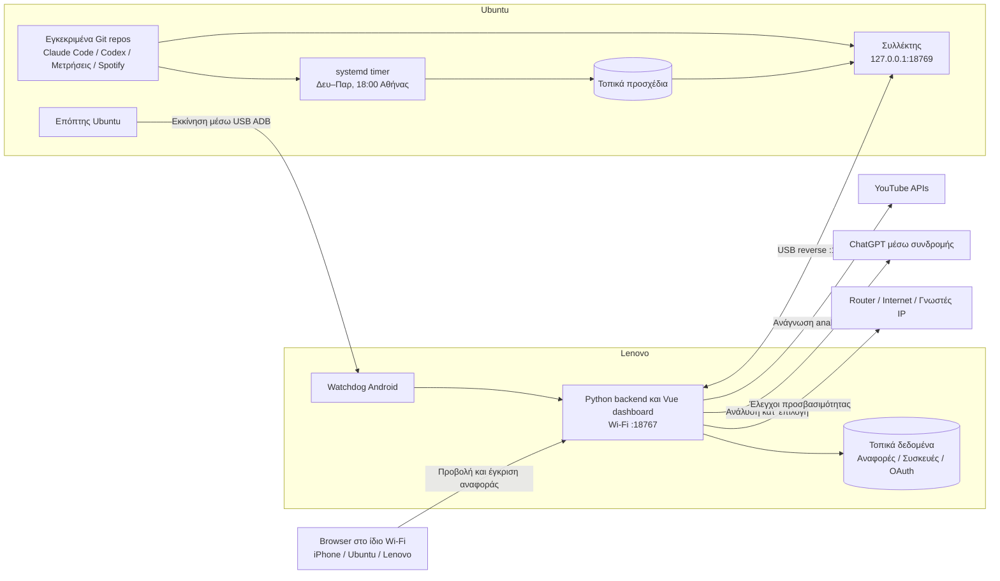

# NEXUS AI

Τοπικό dashboard για εβδομαδιαία δραστηριότητα, stand-up, όρια Claude Code και Codex, μετρήσεις Ubuntu, Spotify, έλεγχο δικτύου και YouTube Growth. Το **Ubuntu συλλέγει** τα δεδομένα εργασίας. Το **Lenovo σερβίρει** το dashboard και κρατά τις εγκεκριμένες αναφορές.

## Γρήγορη εκκίνηση

| Σκοπός | Διεύθυνση |
|---|---|
| Κανονική χρήση από Lenovo, iPhone ή Ubuntu στο ίδιο Wi-Fi | `http://<LENOVO_IP>:18767/` |
| Παλιά διεύθυνση, με προώθηση από ενεργό Ubuntu | `http://<UBUNTU_IP>:8766/` |
| Ξεχωριστή δοκιμή ανάπτυξης στο Ubuntu | [Τοπική δοκιμή](http://127.0.0.1:8767/) |

Βρες τη διεύθυνση Wi-Fi του Lenovo με `adb -d shell ip -4 addr show wlan0` και όρισέ τη στο τερματικό σου ως `LENOVO_IP` για τις εντολές ελέγχου.

Για νέο agent ή νέα συνεδρία, διάβασε πρώτα το [AGENTS.md](AGENTS.md), δες το `git status --short` και χρησιμοποίησε τη **δοκιμή ανάπτυξης** για αλλαγές. Για έλεγχο της ήδη εγκατεστημένης έκδοσης, ξεκίνα από το [λειτουργικό runbook](#υπάρχουσα-εγκατάσταση-lenovo).

### Δοκιμή ανάπτυξης στο Ubuntu

Χρειάζονται Python **3.10+** με διαθέσιμες ζώνες ώρας και Node **22.12+** σε υποστηριζόμενη έκδοση LTS. Η τρέχουσα εγκατάσταση Ubuntu έχει δοκιμαστεί με Python 3.14 και Node 24. Από τη ρίζα του checkout:

```bash
npm --prefix frontend ci
npm --prefix frontend run build
nexus_dev_data=$(mktemp -d)
NEXUS_DATA_DIR="$nexus_dev_data" python3 -B -m backend.web --bind 127.0.0.1 --port 8767
```

Άνοιξε το `http://127.0.0.1:8767/`. Ο Python server σερβίρει το Vue build από `frontend/dist/`. Μετά από αλλαγές UI ξανατρέξε το build και ανανέωσε τη σελίδα. Ο προσωρινός κατάλογος ξεκινά κενός. Οι λειτουργίες που χρειάζονται τον συλλέκτη Ubuntu ή εξωτερική σύνδεση ενδέχεται να εμφανίζουν «Μη διαθέσιμο», ενώ τα όρια CLI μπορούν να διαβαστούν τοπικά με `python3 -B -m backend.limits`.

## Πώς λειτουργεί



Όσο το Lenovo παραμένει αναμμένο, ο watchdog συνεχίζει να λειτουργεί με κλειστό Ubuntu. Παραμένουν προσβάσιμα το ιστορικό, το Δίκτυο και το YouTube Growth, εφόσον έχουν πρόσβαση στις αντίστοιχες υπηρεσίες. Για νέα δεδομένα Git, όρια CLI, μετρήσεις συστήματος και Spotify χρειάζεται ο συλλέκτης Ubuntu και η γέφυρα USB. Μετά από επανεκκίνηση του ίδιου του Lenovo, ο επόπτης εκκινεί ξανά τον watchdog όταν το tablet συνδεθεί μέσω εξουσιοδοτημένου USB.

## Υπάρχουσα εγκατάσταση Lenovo

### Έλεγχος και επανεκκίνηση

Στο Ubuntu, με το tablet στο USB και στο ίδιο Wi-Fi:

```bash
systemctl --user status nexus-lenovo-pilot.service nexus-ubuntu-collector.service
systemctl --user list-timers nexus-daily-standup.timer
adb -d get-state
adb -d reverse --list
curl -fsS "http://${LENOVO_IP:?Όρισε τη διεύθυνση Wi-Fi του Lenovo}:18767/api/status"
```

Το ADB πρέπει να δείχνει `device` και η λίστα reverse να περιέχει `tcp:18769 tcp:18769`. Στο API αναμένονται `backend: true` και, με ενεργό συλλέκτη, `collector: true`. Αν το ADB δείχνει `unauthorized`, ξεκλείδωσε το Lenovo και αποδέξου την εξουσιοδότηση USB debugging. Για επαναφορά των υπηρεσιών Ubuntu:

```bash
systemctl --user restart nexus-ubuntu-collector.service nexus-lenovo-pilot.service
systemctl --user start nexus-daily-standup.timer
journalctl --user -u nexus-ubuntu-collector.service -u nexus-lenovo-pilot.service -n 40 --no-pager
```

Η επανεκκίνηση του επόπτη Ubuntu ελέγχει τον watchdog και επαναφέρει το USB reverse. Για φόρτωση νέου Python κώδικα στο ήδη ενεργό backend, ακολουθεί η διαδικασία ενημέρωσης.

### Ενημέρωση της εγκατεστημένης έκδοσης

Από τη ρίζα του checkout στο Ubuntu:

```bash
(
  set -euo pipefail
  : "${LENOVO_IP:?Όρισε τη διεύθυνση Wi-Fi του Lenovo}"
  remote=$(cat "$HOME/.local/state/nexus-lenovo-pilot/remote")
  [[ "$remote" =~ ^/data/local/tmp/nexus-actual\.[A-Za-z0-9]+$ ]]
  adb -d shell "test -f '$remote/release/launch.py' && test -d '$remote/production-data'"

  npm --prefix frontend ci
  npm --prefix frontend run build
  adb -d push frontend/dist/assets/. "$remote/release/frontend/dist/assets/"
  adb -d push backend/*.py "$remote/release/backend/"
  adb -d push frontend/dist/index.html "$remote/release/frontend/dist/index.html"

  # Ο watchdog επανεκκινεί τον Python server, φορτώνοντας τον νέο κώδικα.
  adb -d shell "pid=\$(cat '$remote/production.pid') &&
    test -n \"\$pid\" &&
    tr '\\000' '\\n' </proc/\"\$pid\"/cmdline | grep -Fxq '$remote/release/launch.py' &&
    kill -TERM \"\$pid\""
  curl -fsS --retry 6 --retry-connrefused --retry-delay 2 --max-time 5 \
    "http://${LENOVO_IP:?Όρισε τη διεύθυνση Wi-Fi του Lenovo}:18767/api/status"
)
```

Η ενημέρωση γράφει μόνο στο `release/`. Για αλλαγή αποκλειστικά στο UI αρκούν το build και τα δύο `adb push` του frontend. Τα assets αντιγράφονται πρώτα και το `index.html` τελευταίο. Για αλλαγή στο ίδιο το `lenovo_watchdog.sh` απαιτείται ξεχωριστή επανεκκίνηση του watchdog, επειδή ο ήδη ενεργός επόπτης Android συνεχίζει να εκτελεί την παλιά έκδοση.

### Επαναφορά υπηρεσιών ή εγκατάσταση σε νέο Ubuntu

Τα units βρίσκονται εκτός checkout στο `~/.config/systemd/user/`. Αν χρειαστεί να τα ξαναδημιουργήσεις, χρησιμοποίησε ως `WorkingDirectory` την απόλυτη διαδρομή του checkout:

| Αρχείο | Ρυθμίσεις |
|---|---|
| `nexus-ubuntu-collector.service` | `[Service]`: `Type=simple`, `WorkingDirectory`, `ExecStart=/usr/bin/python3 -B -u -m backend.collector`, `Restart=always`. `[Install]`: `WantedBy=default.target`. |
| `nexus-lenovo-pilot.service` | Ίδιες ρυθμίσεις, με `ExecStart=/usr/bin/python3 -B -u -m backend.lenovo_supervisor`. |
| `nexus-daily-standup.service` | `[Service]`: `Type=oneshot`, `WorkingDirectory`, `ExecStart=/usr/bin/python3 -B -m backend.scheduled`. |
| `nexus-daily-standup.timer` | `[Timer]`: `OnCalendar=Mon..Fri *-*-* 18:00:00 Europe/Athens`, `Persistent=true`. `[Install]`: `WantedBy=timers.target`. |

Αφού υπάρχουν τα τέσσερα αρχεία και ο δείκτης `~/.local/state/nexus-lenovo-pilot/remote` δείχνει στο υπάρχον runtime του tablet:

```bash
systemctl --user daemon-reload
systemctl --user enable --now nexus-ubuntu-collector.service nexus-lenovo-pilot.service nexus-daily-standup.timer
```

Το checkout από μόνο του έχει τον κώδικα. Για επαναφορά σε tablet χωρίς εγκατεστημένο runtime χρειάζονται το συμβατό portable Python 3.13 και οι βιβλιοθήκες του, ο δείκτης `remote`, τα αρχεία `tz/Europe/Athens` και `tz/America/Los_Angeles`, και η παρακάτω διάταξη. Το portable runtime και τα δεδομένα παραγωγής αποκαθίστανται από έμπιστο τοπικό αντίγραφο. Αν αλλάξει η IP του Lenovo ή του Ubuntu, έλεγξε τις διευθύνσεις στο watchdog, στα ορίσματα του συλλέκτη και στις Android συντομεύσεις πριν τη δοκιμή.

```text
<remote>/bin/python3.13
<remote>/lib/
<remote>/tz/Europe/Athens
<remote>/tz/America/Los_Angeles
<remote>/release/launch.py
<remote>/release/lenovo_watchdog.sh
<remote>/release/backend/
<remote>/release/frontend/dist/
<remote>/production-data/
```

Το `release/launch.py` της εγκατάστασης είναι ο ακόλουθος launcher. Το `backend/lenovo_watchdog.sh` του repo εγκαθίσταται ως `release/lenovo_watchdog.sh`.

```python
import os
from pathlib import Path

from backend.web import main

Path(os.environ["PILOT_PID_FILE"]).write_text(str(os.getpid()))
main()
```

Οι εφαρμογές **NEXUS Backend** και **NEXUS Dashboard** στο Lenovo είναι Android wrappers του υπάρχοντος server. Για νέο APK, το `frontend/android/build.sh <φάκελος-εξόδου>` χρησιμοποιεί `JAVA_HOME`, `ANDROID_HOME`, Android SDK 34, Build Tools 34.0.0 και τις τοπικές ρυθμίσεις υπογραφής `NEXUS_ANDROID_KEYSTORE` και `NEXUS_ANDROID_KEYSTORE_PASSWORD`.

## Χρήση και συνδέσεις

- **Εργασίες Εβδομάδας / Daily stand-up.** Οι επιτρεπόμενες πηγές Git ορίζονται στο `backend/activity.py`. Ο timer παράγει προσχέδιο Δευτέρα έως Παρασκευή στις 18:00 Αθήνας. Άνοιξέ το από **Προς έγκριση** ή από την ημέρα της εβδομάδας. Η τελική αναφορά αποθηκεύεται στο Lenovo αφού την εγκρίνεις. Για διαγραφή, άνοιξε **Λεπτομέρειες ημέρας → Ενέργειες αναφοράς → Διαγραφή αναφοράς** και επιβεβαίωσε.
- **Όρια χρήσης.** Η κάτω λωρίδα δείχνει 5ωρο και 7ήμερο για Claude Code και Codex. Πάτησέ τη για επαναφορά και τελευταία ενημέρωση σε ώρα Αθήνας.
- **Σύστημα.** Ο συλλέκτης Ubuntu παρέχει μετρήσεις και Spotify μέσω MPRIS. Άνοιξε **NEXUS Spotify QR** στο Ubuntu για σύζευξη συσκευής. Το QR ισχύει πέντε λεπτά για μία σύζευξη. Ανάκληση από **Σύστημα → Αποσύνδεση συσκευής**.
- **Δίκτυο.** Το Lenovo ελέγχει χωριστά router, Internet και τις IP που καταχωρίζεις. Η ένδειξη «Δεν απαντά» σημαίνει ότι ο έλεγχος δεν εντόπισε τη συσκευή.

### YouTube Growth

Εμφανίζει έως 50 πρόσφατα δημόσια βίντεο, με διαχωρισμό Long videos / Shorts, μετρήσεις 30 ημερών και retention όπου υπάρχει. Από την **Ανάλυση** δίνεις το θέμα του επόμενου βίντεο, επιλέγεις τύπο, μοντέλο και αριθμό προηγούμενων βίντεο. Οι προτάσεις εμφανίζονται σε καρτέλες για τίτλους, περιγραφή, tags και thumbnails. Τίτλοι, περιγραφή και tags αντιγράφονται από τις αντίστοιχες κάρτες. Ο μετρητής tags εφαρμόζει το όριο των 500 χαρακτήρων του YouTube.

Για αρχική σύνδεση ή επανέγκριση, ενεργοποίησε τα **YouTube Data API v3**, **YouTube Analytics API** και **YouTube Reporting API** στο ίδιο Google Cloud project. Στο Google Auth Platform πρόσθεσε τον λογαριασμό σου ως test user αν η εφαρμογή είναι σε Testing. Δημιούργησε OAuth client τύπου **Desktop app** και κράτησε το JSON εκτός checkout. Από το Ubuntu, με το Lenovo στο USB:

```bash
python3 -B -m backend.youtube_pair /διαδρομή/client.json UC...
python3 -B -m backend.chatgpt_pair
```

Εκτέλεσε τις εντολές χωριστά και άνοιξε κάθε επίσημο σύνδεσμο έγκρισης στον browser του Ubuntu. Η πρώτη επαληθεύει το Channel ID και η δεύτερη ζητά άδεια χρήσης της συνδρομής ChatGPT. Η δεύτερη χρειάζεται τη βιβλιοθήκη Python `cryptography` στο Ubuntu. Οι συνδέσεις παραμένουν ενεργές μετά από ενημέρωση του κώδικα. Αν το Google OAuth είναι σε Testing, η Google μπορεί να ζητήσει επανέγκριση μετά από επτά ημέρες. Το πρώτο Reach report μπορεί να χρειαστεί έως 24 ώρες, οπότε Impressions και CTR ενδέχεται αρχικά να λείπουν.

Η ανάλυση ChatGPT χρησιμοποιεί την περιγραφή του νέου βίντεο και επιλεγμένα μεταδεδομένα από δημόσια βίντεο του καναλιού. Όταν λείπει η έγκριση, η υπηρεσία δεν είναι διαθέσιμη ή επιτευχθεί όριο χρήσης, εμφανίζεται τοπική ανάλυση. Η ενσωμάτωση χρησιμοποιεί το OAuth της συνδρομής.

## Αρχεία, δεδομένα και συνέχεια

- [backend/](backend/) για HTTP, συλλογή, αναφορές και ενσωματώσεις. [frontend/](frontend/) για Vue 3, Vuetify, Composition API και Android wrappers.
- Ενεργές αναφορές, γνωστές συσκευές και OAuth αποθηκεύονται στο `NEXUS_DATA_DIR` του Lenovo, στο `production-data/`. Τα προσχέδια Ubuntu μένουν στο `~/.local/share/nexus-ai/drafts/` εκτός αν οριστεί `NEXUS_DRAFTS_DIR`.
- Στο Git μπαίνουν κώδικας και τεκμηρίωση. Διατήρησε OAuth JSON, tokens, αναφορές, καταγραφές, signing keystore και τοπικές ρυθμίσεις εκτός checkout. Κατά την αντιμετώπιση προβλήματος έλεγξε κατάσταση και δικαιώματα αρχείων χωρίς να εμφανίζεις περιεχόμενα διαπιστευτηρίων.
- Για λεπτομέρειες και περιορισμούς συλλογής, δες [docs/architecture.md](docs/architecture.md) και [AGENTS.md](AGENTS.md).
